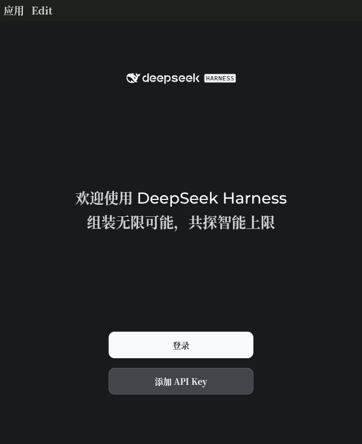

# deepseek-harness-desktop-wayland

[](https://github.com/deepseek-ai/deepseek-harness)
[](#产物)
[](LICENSE)

基于官方 **DeepSeek Harness `dsh-v0.2.2-rc.3`** 源码、面向 **Arch Linux / niri (Wayland) / NVIDIA** 的全新 Linux 桌面端构建。

> 仓库地址：<https://github.com/Moritz230127/deepseek-harness-desktop-wayland>
> 本仓库**不复用**旧 `deepseek-harness-desktop-linux` 的 48 文件补丁系列，而是从官方 rc.3 源码重新分析、重写最小补丁（16 个）。

## 特性

- **忠实官方源码**：补丁只做「让官方 macOS/Windows 流水线在 Linux 上工作 + 必要运行时收敛」，不含托盘、主题、磨砂、remote bridge、TUI 等美化/附加功能。
- **原生 Wayland**：不安装、不启动任何 X11/XWayland 回退路径；Wayland 会话下强制 `--ozone-platform=wayland`。
- **GPU 渲染优先 + 硬解**：默认 GPU 合成（ANGLE OpenGL / NVIDIA 硬件）与 VA-API/NVDEC 视频硬解；只有 GPU 进程彻底不可用时才做一次软件渲染兜底（仍原生 Wayland）。
- **稳定、无闪烁**：8 组隔离场景 ×~105 s 矩阵 0 次 GPU 崩溃/FATAL、静止画面截图无差异；深色主题首帧背景色跟随主题（无白闪）。
- **零 DevTools console 报错**：全新 profile 与「用户 profile（移除实验 Inspector bundle）」下均 0 error / 0 warning（详见 [docs/build-verification.md](docs/build-verification.md)）。
- **无应用内更新**：pacman 统一管更新；Linux 上隐藏「检查更新」入口。
- **无顶栏菜单**：Linux 上移除上游 GTK「应用/Edit」菜单条，F12 仍可打开 DevTools。

## 产物

| 项 | 值 |
|---|---|
| 包名 | `deepseek-harness-desktop-wayland` |
| 版本 | `0.2.2rc3-1`（上游 `dsh-v0.2.2-rc.3`，commit `38a6a5c9…`） |
| 安装根 | `/opt/deepseek-harness-desktop-wayland`（1.12 GB 解包） |
| 启动器 | `/usr/bin/deepseek-harness-wayland`（+ 兼容 symlink `/usr/bin/deepseek-harness`） |
| pacman 包 | `deepseek-harness-desktop-wayland-0.2.2rc3-1-x86_64.pkg.tar.zst`（341 MB） |
| sha256 | `63065ea76b04f649f9c34fb38e03f55742b38da2fbddc0194375d60878aaf888` |
| 官方归档 sha256 | `bf6d668e52a26edf98aa2ef7960e240c8d9afcefbad2b09887a2cb1e14001dd5` |

本机分发：已发布到 `[localrepo]`（`/srv/localrepo`）。GitHub Release：<https://github.com/Moritz230127/deepseek-harness-desktop-wayland/releases/tag/v0.2.2rc3-1>（含同名二进制包、SHA256SUMS、metadata.env）。

## 安装 / 回滚

```bash
# 1) 刷新 localrepo 元数据（本机 /srv/localrepo）
sudo pacman -Sy

# 2) 安装新包；pacman 会提示替换旧的 deepseek-harness-desktop-linux
sudo pacman -S deepseek-harness-desktop-wayland

# 3) 关闭正在运行的旧桌面端，然后从应用菜单启动 "DeepSeek Harness"
#    （用户级 ~/.local/share/applications/deepseek-harness.desktop 若存在，其 Exec 仍兼容）
```

回滚：

```bash
sudo pacman -R deepseek-harness-desktop-wayland
sudo pacman -S deepseek-harness-desktop-linux   # 旧包仍在 localrepo
```

### 零报错验收前置（用户 profile）

若 `~/.dsh/profiles/desktop/package.json` 的 `dsh.profile.bundles` 中含
`"@deepseek-ai/dsh-experimental-inspector-profile"`，请移除该项（同时消除 9230 无认证 CDP 调试端口的安全风险），否则 DevTools console 会有 19 条 Agent 侧的 ingest 连接错误。

## 截图

顶栏菜单移除（同一欢迎页）：

| 修复前（上游 Linux 默认） | 修复后（本包） |
|---|---|
|  |  |

## 验证摘要

| 验收项 | 结果 |
|---|---|
| 官方 rc.3 源码构建 | ✅ `@deepseek-ai/dsh-desktop 0.2.2-rc.3`，commit `38a6a5c9…` |
| 原生 Wayland | ✅ 进程 `--ozone-platform=wayland`，无 X11/XWayland 回退；niri `app_id=deepseek-harness` |
| NVIDIA 稳定性 | ✅ 8 组合 ×105–106 s：0 GPU 崩溃/FATAL；滚动 p95≈7 ms、>50 ms 掉帧 0；静止截图 AE≈0 |
| GPU 渲染 / 硬解 | ✅ `gpu_compositing=enabled`、`video_decode=enabled`、ANGLE NVIDIA OpenGL；`video_encode` 仍软件（Chromium/NVIDIA 限制） |
| 无白闪 | ✅ Linux 主窗口/welcome 首帧背景色跟随主题 |
| DevTools console | ✅ fresh profile：0 error / 0 warning；用户 profile（移除 Inspector bundle）：0 error / 0 warning |
| 补丁规模 | 16 个：构建启用 0001–0010（43 文件 / +414 −125）+ 运行期 0011–0016（199 行） |

完整报告：[docs/build-verification.md](docs/build-verification.md) · [docs/console-errors.md](docs/console-errors.md) · [docs/wayland-stability.md](docs/wayland-stability.md) · [docs/patch-design.md](docs/patch-design.md)

## 运行期设计（launcher）

`/usr/bin/deepseek-harness-wayland` → `packaging/launcher/deepseek-harness`：

- Wayland 会话：强制 `--ozone-platform=wayland`；
- 默认 `--disable-features=Vulkan`（NVIDIA+Wayland 保险，实测无副作用；ANGLE 仍在 OpenGL 路径）；
- 硬解/光栅化 flags（与同机 Google Chrome 153 实测组合一致）：
  `--enable-features=WaylandLinuxDrmSyncobj,VaapiOnNvidiaGPUs,AcceleratedVideoDecodeLinuxGL,AcceleratedVideoDecodeLinuxZeroCopyGL,PlatformHEVCDecoderSupport`
  + `--enable-gpu-rasterization --enable-zero-copy`；
- `LIBVA_DRIVER_NAME=nvidia` 仅在缺失且存在 `nvidia_drv_video.so` 时兜底；
- GPU 彻底不可用（exit 75 / SIGTRAP + GPU 关键日志）时只重试一次 `--disable-gpu --disable-gpu-compositing`，仍是原生 Wayland，不切 X11。

可调开关：`DSH_GPU_HWDECODE=0`、`DSH_GPU_RASTERIZATION=0`、`DSH_GPU_ZERO_COPY=0`、`DSH_WAYLAND_SYNCOBJ=0`、`DSH_GPU_FALLBACK=0`、`DSH_GPU_SOFTWARE=1`、`DSH_NO_SANDBOX=1`。

## 构建

前置：Arch（`base-devel`）、`nodejs`、`pnpm`、`python`。仓库要求 pnpm 11.x 且入口可被 node 执行；若系统 pnpm 是二进制入口，构建脚本会回退到隔离版：

```bash
npm i --prefix ~/.local/share/dsh-pnpm-11 pnpm@11.28.5
```

两种方式：

```bash
# A. 全量源码包（可复现；prepare() 从官方归档重建并应用 16 补丁，build() 跑官方流水线）
cd packaging && makepkg -C -s --nocheck

# B. 预构建载荷包（快速交付；复用已构建的 linux-unpacked）
ci/package-wayland.sh <linux-unpacked> <out-dir> 0.2.2rc3

# C. 手工构建（调试用）
ci/build-wayland.sh <upstream-tree> --dir   # 需仍为已应用补丁的树
```

产物布局：`apps/desktop/.desktop-build/targets/linux-x64/unsigned-artifacts/linux-unpacked`。

构建环境已处理的坑（详见 docs/build-verification.md）：系统 pnpm 12 二进制入口、`/tmp` noexec 导致的 koffi 预编译失败、release tarball 无 `.git` 的 commit 注入、打包期内部 pnpm 的 registry 镜像。

## 补丁系列（16 个）

### 构建启用（0001–0010，43 文件 / +414 −125）

基于 [ffyfox/dsh-desktop-linux](https://github.com/ffyfox/dsh-desktop-linux)（MIT）的 Linux 移植经验**重写并精简**，删掉全部测试/deb/rpm/AppImage 与美化 hunk：

| # | 内容 |
|---|---|
| 0001 | desktop target 模型支持 `linux-x64` |
| 0002 | `package-target.ts` 支持 Linux target |
| 0003 | electron-builder Linux 配置（asar 关闭、desktopName、icon、无策略） |
| 0004 | 分发 Electron 二进制（Linux 解压布局） |
| 0005 | `.env.linux` 发布设置 + 工具链探测（Linux） |
| 0006 | Linux 打包 scripts；local profile 也带官方品牌 |
| 0007 | Host 改为 primary-runtime 独立 Node（Linux 上不用 Electron Node 模式） |
| 0008 | 打包/冒烟链路适配 Linux 独立 Node |
| 0009 | Linux 不嵌入/不轮询强制更新策略（policy opt-out） |
| 0010 | release 源码无 `.git` 时从环境录制 build commit |

### 运行期收敛（0011–0016，199 行）

| # | 内容 |
|---|---|
| 0011 | Linux 主窗口/welcome 首帧背景色跟随主题（消除白闪） |
| 0012 | Linux 隐藏「检查更新…」菜单项（pacman 管更新） |
| 0013 | GPU `launch-failed` 时 `app.exit(75)` 交 launcher 一次性软件渲染兜底 |
| 0014 | account profile 读取失败在 Linux 降级为 info（无账户后端属预期） |
| 0015 | 会话 reference 已释放属正常 teardown，不再打 error |
| 0016 | Linux 移除 GTK 应用菜单条（`Menu.setApplicationMenu(null)`），F12 保留 DevTools |

每个补丁都验证过：pristine rc.3 上按序 `git apply --check` 全通过；`patch -Np1` 通过；`makepkg --nodeps --nobuild` 的 prepare 阶段通过。

## 已知限制

- `video_encode` 在 Chromium/NVIDIA 上为 `disabled_software`：**解码硬解**已启用，**编码**仍走软件。
- niri 26.04 未宣告 `linux-drm-syncobj-v1`，显式同步 flag 当前为 no-op（保留前向兼容）。
- 稳定性覆盖：8 组合 ×~105 s 矩阵 + 最终包抽测；**24 h+ soak、挂起/恢复、多显示器**未覆盖。
- 本仓库是**本地预构建载荷包**的构建/打包项目（非 AUR 发布）；可复现性由官方归档 sha256 + 16 补丁 + 构建脚本保证。
- 用户 profile 内插件仍 pin 在 0.2.2-rc.1；桌面升级后若插件异常，在插件管理页更新对应插件。

## 仓库结构

```
ci/          build-wayland.sh（构建）/ package-wayland.sh（打包）
patches/     16 个补丁（0001–0016）
packaging/   PKGBUILD（源码包）、PKGBUILD.prebuilt（快速交付）、launcher、desktop、systemd、icons、AppArmor、install
docs/        验证/归因/补丁设计文档 + 证据截图
launcher/    launcher 副本（研究交付位置）
reference/   ffyfox-patches 参考基线（MIT，未直接作为运行时补丁）
```

## 发布与维护

- 本机 localrepo 发布与 GitHub Release 流程见 [docs/publish.md](docs/publish.md)。
- 仓库默认 **private**；需要公开时：`gh repo edit --visibility public --accept-visibility-change-consequences`。
- 本机 git 全局配置了 `gh-proxy` 的 `insteadOf` 重写，推送需绕过（详见 docs/publish.md 的命令）。

## 许可与致谢

- 上游：[deepseek-ai/deepseek-harness](https://github.com/deepseek-ai/deepseek-harness)（MIT）
- 参考：ffyfox/dsh-desktop-linux（MIT）的官方流水线 Linux 移植思路；补丁 0001–0010 为其经验的重写精简版
- 本仓库：MIT
