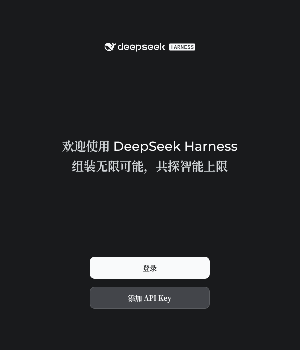

# DeepSeek Harness Desktop · Linux (Wayland)

[](https://github.com/Moritz230127/deepseek-harness-desktop-wayland/actions/workflows/build.yml)
[](https://github.com/Moritz230127/deepseek-harness-desktop-wayland/releases/tag/rolling)
[](https://archlinux.org)
[](https://github.com/deepseek-ai/deepseek-harness)
[](LICENSE)

面向 **Arch Linux / Wayland** 的非官方 **DeepSeek Harness Desktop** 构建：打包官方 Electron shell 与内置 `dsh` runtime，补上 Linux 构建接线和必要的运行时收敛。跟踪上游 `master`，以滚动 pacman 仓库分发。

> **非 DeepSeek 官方发行版。** 上游项目是 [deepseek-ai/deepseek-harness](https://github.com/deepseek-ai/deepseek-harness)（MIT）；本仓库只负责 Linux 构建、最小补丁和 pacman 打包。使用问题请提到本仓库，不要打扰上游。



## 特性

- **尽量忠实上游**：17 个补丁，只做 Linux 构建使能和必要的运行时修正；不添加托盘、主题、磨砂、TUI、remote bridge 等附加功能。
- **原生 Wayland**：Wayland 会话下强制 `--ozone-platform=wayland`，不主动回退 X11 / XWayland。
- **NVIDIA 可用**：默认 GPU 合成与 VA-API/NVDEC 硬解；GPU 进程彻底不可用时才做一次软件渲染兜底，仍保持原生 Wayland。
- **pacman 统一更新**：移除应用内更新入口，升级/回滚都由 pacman 负责。
- **干净的 Linux 窗口**：移除上游 GTK 应用菜单条；`F12` 仍可打开 DevTools。
- **可复现构建**：每次构建固定到 40 位上游 commit；CI 在 Arch 容器里构建并跑构建门禁与打包后冒烟。

### NVIDIA + niri 的显示稳定性（重要）

niri 26.04 还没有实现 `linux-drm-syncobj-v1`（explicit sync）。NVIDIA 下 Chromium/Electron
的 GPU 合成与 niri 的 DRM 提交之间只能用隐式同步，偶发黑块、错位、频闪——这不是 dsh
源码能修的，也不是 launcher flag 能修的。niri 侧的最小、已验证缓解手段是在
`~/.config/niri/config.kdl` 的 `debug {}` 里加一行：

```kdl
debug {
    wait-for-frame-completion-before-queueing
}
```

它让 niri 在把帧交给 DRM 前等待本帧 GPU 渲染完成，直接消除该竞态；代价是合成器线程
每帧多等一次渲染完成（UI 场景通常 <1ms，游戏可能少几帧）。原理、备选方案和回退见
[docs/nvidia-niri.md](docs/nvidia-niri.md)。

装好包后可以先跑 `dsh-wayland-doctor`：它会只读检查会话、GPU、niri 的 explicit sync/
wait-for-frame、dsh 的 GPU 进程与日志，并打印下一步建议。

## 安装

要求：Arch Linux `x86_64`，以及一个可用的 Wayland 会话（niri、Hyprland、KDE Wayland 等）。

在 `/etc/pacman.conf` 末尾新增一个**只属于 DSH** 的仓库段：

```ini
[dsh]
SigLevel = Optional TrustAll
Server = https://github.com/Moritz230127/deepseek-harness-desktop-wayland/releases/download/rolling
```

```bash
sudo pacman -Syy
sudo pacman -S deepseek-harness-desktop-wayland
```

安装后从应用菜单启动 **DeepSeek Harness**，或运行：

```bash
deepseek-harness-wayland
```

以后更新：

```bash
paru -Syu
# 或
sudo pacman -Syu
```

确认版本：

```bash
pacman -Q deepseek-harness-desktop-wayland
```

> 包没有做 pacman 签名，所以 `SigLevel` 使用 `Optional TrustAll`；分发依赖 GitHub HTTPS 和 Release 里的 `SHA256SUMS`。介意的话可以在安装前自行下载核对。

### 包信息

| 项 | 值 |
|---|---|
| 包名 | `deepseek-harness-desktop-wayland` |
| 安装根 | `/opt/deepseek-harness-desktop-wayland` |
| 启动器 | `/usr/bin/deepseek-harness-wayland`（兼容 symlink `/usr/bin/deepseek-harness`） |
| 诊断 | `/usr/bin/dsh-wayland-doctor`（只读检查 NVIDIA/niri 稳定性配置） |
| 桌面入口 | `/usr/share/applications/deepseek-harness.desktop` |
| 下载 / 安装体积 | 约 360 MB / 1.1 GB |
| 替换 | `deepseek-harness-desktop-linux`、`deepseek-harness-desktop-linux-bin` 等旧包 |

### 回滚

`rolling` Release 保留最近几个版本化包，可以直接按文件名回滚：

```bash
sudo pacman -U https://github.com/Moritz230127/deepseek-harness-desktop-wayland/releases/download/rolling/deepseek-harness-desktop-wayland-<旧版本>-x86_64.pkg.tar.zst
```

## 版本与发布

本仓库以 AUR `-git` 的方式跟踪上游 `master` 的**当前 head**：

```text
pkgver = <上游版本>.r<相对最近 tag 的提交数>.g<短 SHA>
例：0.2.2rc4.r1407.gca33fd6-1
```

- 每 **5 分钟**检查一次上游；master 构建有 1 小时 cooldown，上游新 tag 会绕过 cooldown 立即构建，`pkgver` 永远对应一个 40 位 commit。
- GitHub 的 `schedule` 在本仓库实测会长时间不触发（2026-11-22 12:00Z 档 20+ 分钟未启动）。
  关键路径用 [docs/upstream-watch.md](docs/upstream-watch.md) 的 5 分钟 PAT watcher 触发
  `repository_dispatch`；5 分钟 cron 和 `push` 触发只做兜底。
- 同一上游 SHA 下只改 `patches/` 时，CI 自动 `pkgrel+1` 重建（不再需要手动 `force`）。
- 只有 docs/tests 变更才跳过；补丁变化、强制重建、版本回退都有显式保护。
- 所有构建发布到**同一个** [`rolling` Release](https://github.com/Moritz230127/deepseek-harness-desktop-wayland/releases/tag/rolling)，不会为每个 commit 创建 tag/release。
- Release 内含版本化 `.pkg.tar.zst`、pacman 数据库 `dsh.db`、`latest`、`SHA256SUMS` 和构建来源 `metadata.env`。
- 构建失败不会发布；会自动创建/更新 `ci-failure` issue。上一次成功的包保持可用。

### 这是不是 `dsh-git`？

**语义上是，包名不是。** 本包等价于 AUR 的 `-git` 包：

- `pkgver` 是 `master` 当前 head 的 `<上游版本>.r<提交数>.g<短 SHA>`，每次构建固定一个 40 位 commit；
- 每 5 分钟检查上游，master 构建 1 小时 cooldown，新 tag 绕过 cooldown 立即构建；
- 补丁变化自动 `pkgrel+1`，不需要手动 `force`。

包名仍保留 `deepseek-harness-desktop-wayland`，是为了避免 pacman 包名迁移。若要与 AUR
完全对齐，可改名为 `dsh-git`，同时加：

```bash
provides=('dsh' 'deepseek-harness-desktop')
conflicts=('dsh' 'deepseek-harness-desktop-wayland' ...)
replaces=('deepseek-harness-desktop-wayland')
```

这是一次性的包名迁移，不影响 `/opt` 安装路径和启动器。AUR 的 `-git` 是用户本机
`makepkg` 时随时重建；这里是 CI 预构建二进制，必须有 cooldown，否则 359 MB 包会每几分钟
上传一次，带宽和 Release 存储都不可持续。
- 完整规则见 [docs/automation.md](docs/automation.md)。

## 从源码构建

需要 Arch（`base-devel`）、`nodejs`、`pnpm` 11.x、`python`。首次准备隔离的 pnpm：

```bash
npm i --prefix ~/.local/share/dsh-pnpm-11 pnpm@11.28.5
```

```bash
git clone https://github.com/Moritz230127/deepseek-harness-desktop-wayland.git
cd deepseek-harness-desktop-wayland/packaging
makepkg -C -s --nocheck
```

PKGBUILD 默认固定到仓库内一个已验证的 commit，**不会**自动追最新 master；日常安装请直接用上面的滚动仓库。要手动构建其他上游版本，传入：

```bash
DSH_PKGVER=<上游版本>.r<提交数>.g<短SHA> \
DSH_UPSTREAM_REF=<40位 commit> \
DSH_UPSTREAM_COMMIT=<40位 commit> \
DSH_UPSTREAM_SHA256=<上游 archive 的 sha256> \
makepkg -C -s --nocheck
```

构建会下载 Electron、Node 和 Python runtime，首次需要网络。产物在：

```text
apps/desktop/.desktop-build/targets/linux-x64/unsigned-artifacts/linux-unpacked
```

CI 使用 `archlinux:base-devel` 容器构建，脚本见 [ci/](ci/)；发布流程见 [docs/publish.md](docs/publish.md)。

## 补丁系列

补丁按“构建使能”和“运行时收敛”分组；完整说明、逐条目的和验证记录见 [docs/patch-design.md](docs/patch-design.md)。

| 组 | 补丁 | 作用 |
|---|---|---|
| 构建使能 | `0001`–`0010` | Linux target、electron-builder 配置、Electron/Host runtime、打包脚本、policy opt-out、build commit 录制 |
| 运行时收敛 | `0011`–`0017` | 首帧背景色、隐藏更新入口、GPU 兜底、账户/会话日志降噪、移除 GTK 菜单条、404 收敛 |

上游 `master` 变动导致补丁不再 apply 时，CI 会在 `prepare()` 阶段直接失败，不会发布半成品；本地修复流程见 [docs/automation.md](docs/automation.md)。

## 验证

每次 CI 构建会跑：

- 上游 `package:linux:x64:dir` 的 10 项 build gate（typecheck、Host/Desktop/Client bundle、Web build 等）；
- 打包后的 runtime、CLI 插件安装/卸载、Office 文档 round-trip 冒烟。

历史验证证据（Wayland、NVIDIA 稳定性、console 0 error、菜单条修复）见：

- [docs/build-verification.md](docs/build-verification.md)
- [docs/wayland-stability.md](docs/wayland-stability.md)
- [docs/console-errors.md](docs/console-errors.md)

## 已知限制

- `video_encode` 在 Chromium/NVIDIA 上仍是软件实现；**解码**硬解可用，**编码**不可用。
- niri 26.04 尚未宣告 `linux-drm-syncobj-v1`，`--enable-features=WaylandLinuxDrmSyncobj` 当前为 no-op；
  NVIDIA 用户请在 niri 侧启用 `debug { wait-for-frame-completion-before-queueing }`（见 [docs/nvidia-niri.md](docs/nvidia-niri.md)）。
- 稳定性覆盖主要是短时矩阵和最终包抽测；**24h+ soak、挂起/恢复、多显示器**未系统覆盖。
- 这是滚动包，上游 `master` 偶尔会短暂不可构建；CI 失败时保持上一版，不会自动升级到坏包。
- 只提供 Arch Linux `x86_64` 包；其他发行版需要自行改 PKGBUILD。

## 仓库结构

```text
.github/workflows/build.yml   5 分钟检查 / 1 小时 cooldown、Arch 容器构建、rolling 发布、失败 issue、发版通知
ci/                           构建/解析/发布/本地兜底脚本
packaging/                    PKGBUILD、launcher、desktop entry、systemd unit、icon、AppArmor
patches/                      0001–0017 最小补丁系列
docs/                         自动化、补丁设计、验证报告、发布说明
launcher/                     launcher 源文件
reference/                    ffyfox 的 Linux 移植参考补丁（MIT，仅参考）
research/                     早期设计记录
```

## FAQ

**为什么不用 AUR？**

AUR 只存源码配方，用户要自己重新编译 Electron 应用。这里分发的是约 360 MB 的二进制包，更适合用独立的 pacman 仓库。

**会自动更新吗？**

不会在应用内更新。CI 只负责构建和发布，更新由 `paru -Syu` / `pacman -Syu` 触发。

**包坏了怎么办？**

`rolling` Release 保留旧版本，可用 `pacman -U <旧包 URL>` 回滚；本机也可以保留旧包文件。

**为什么版本号这么长？**

`0.2.2rc4.r1407.gca33fd6-1` 对应上游 `0.2.2-rc.4` 之后第 1407 个提交、commit `ca33fd6`，保证每个包都能追溯到确切上游代码。

**和上游官方桌面端是什么关系？**

使用官方源码和官方构建流水线，只补 Linux 需要的接线；不是 DeepSeek 官方发行版，也不修改产品功能。

## 许可与致谢

- 上游：[deepseek-ai/deepseek-harness](https://github.com/deepseek-ai/deepseek-harness)（MIT）
- Linux 移植参考：[ffyfox/dsh-desktop-linux](https://github.com/ffyfox/dsh-desktop-linux)（MIT）；`reference/` 中保留参考补丁，不参与运行时构建
- 本仓库：MIT
