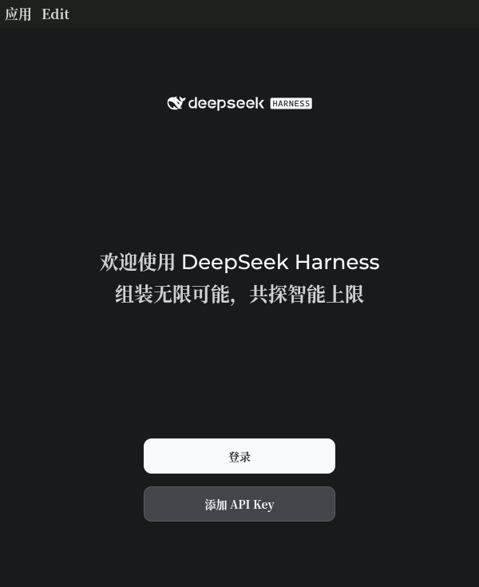
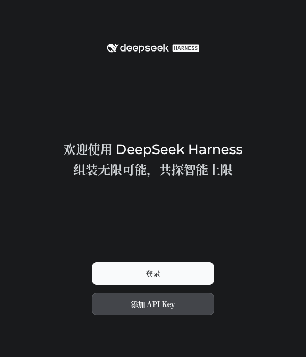

# rc.3 全新 Wayland 桌面包 · 构建与验证报告

> 日期：**2026-11-14**（Asia/Shanghai）。任务：从官方 `dsh-v0.2.2-rc.3` 源码构建**全新** Linux 桌面端（不沿用旧 48 文件补丁），原生 Wayland、NVIDIA 下稳定、GPU 硬解优先、无美化，并消除 DevTools console 报错。
> 交付源码仓库：`/home/Arch/dsh-re/dsh-desktop-wayland`（独立 git 仓库，含 16 个补丁、构建/打包脚本、launcher/PKGBUILD/文档）。
> 关联底稿：[rc3-console-errors.md](rc3-console-errors.md)、[rc3-wayland-stability.md](rc3-wayland-stability.md)、[rc3-patch-design.md](rc3-patch-design.md)。

---

## 0. 结论

| 验收项 | 结果 |
|---|---|
| 官方 rc.3 源码构建 | ✅ 成功；`@deepseek-ai/dsh-desktop 0.2.2-rc.3`，commit `38a6a5c9…`，官方归档 sha256 `bf6d668e…` |
| 全新补丁系列（非旧包更新） | ✅ 16 个补丁：构建启用 0001–0010（43 文件 +414/−125）+ 运行期 0011–0016（199 行）；旧补丁的托盘/主题/磨砂/locale/remote bridge 全部不采用 |
| 原生 Wayland | ✅ 进程 `--ozone-platform=wayland`，无 X11/XWayland 回退；niri 窗口 `app_id=deepseek-harness` |
| NVIDIA 渲染稳定 | ✅ 8 组隔离矩阵各 105–106 s：0 次 GPU 崩溃/FATAL，GPU 进程 PID 全程不变；滚动 1729 帧/12 s，p95≈7 ms、>50 ms 掉帧 0；静止截图相邻 AE≈0 |
| 页面不闪烁/不白闪 | ✅ 静止截图对比无差异；Linux 主窗口/welcome 首帧背景色跟随主题（补丁 0011），深色下无白底闪 |
| GPU 渲染 + 硬解优先 | ✅ `gpu_compositing=enabled`、`video_decode=enabled`、ANGLE NVIDIA OpenGL 硬件路径；launcher 默认 VA-API/NVDEC flags（同机 Chrome 实测组合）；仅 GPU 彻底不可用时一次软件兜底 |
| 顶栏菜单隐藏（用户要求） | ✅ 新包 Linux 移除 GTK「应用/Edit」菜单条（补丁 0016）；F12 DevTools 保留；见下方截图 |
| 零 console 报错 | ✅ 新包 fresh profile：**0 error / 0 warning**（4 条 info）；用户 profile（移除实验 Inspector bundle）：**0 error / 0 warning**（3 条 info） |
| 无应用内更新 | ✅ 隐藏「检查更新…」入口；policy 在 Linux 不嵌入/不轮询 |
| 交付包 | ✅ `deepseek-harness-desktop-wayland-0.2.2rc3-1-x86_64.pkg.tar.zst`（341 MB），已发布到本机 `[localrepo]` |

**安装（用户执行）**：

```bash
sudo pacman -Sy                                     # 让 pacman 看到 localrepo 新条目
sudo pacman -S deepseek-harness-desktop-wayland     # 按提示替换旧 deepseek-harness-desktop-linux
# 然后关闭正在运行的旧桌面端，从应用菜单启动 "DeepSeek Harness"
```

**回滚**：`sudo pacman -R deepseek-harness-desktop-wayland && sudo pacman -S deepseek-harness-desktop-linux`（旧包仍在 localrepo）。

包 sha256：`63065ea76b04f649f9c34fb38e03f55742b38da2fbddc0194375d60878aaf888`。

---

## 1. 构建事实

| 项 | 值 |
|---|---|
| 上游 tag / commit | `dsh-v0.2.2-rc.3` / `38a6a5c965aa99ab525161efb7cc5cf1fe62fced` |
| 官方归档 | `https://github.com/deepseek-ai/deepseek-harness/archive/dsh-v0.2.2-rc.3.tar.gz`，sha256 `bf6d668e52a26edf98aa2ef7960e240c8d9afcefbad2b09887a2cb1e14001dd5` |
| Electron | 44.7.0（Chromium 152.0.7977.130） |
| 构建方式 | 官方流水线：`pnpm install` → `build:official` → `release:pack` → `prepare:runtime/packages/dsh` → `electron-builder --linux --x64 --dir`；日志 `~/dsh-builds/rc3-wayland/{build1..4}.log` |
| 产物 | `linux-unpacked` 1.2 GB（含 primary-runtime：Node 24.21 / pnpm 11.28.5 / Python 3.12 / Office 资源） |
| 包格式 | pacman 预构建载荷包（本地构建）；源码可复现构建入口 `packaging/PKGBUILD` |

构建过程中解决的环境问题（均已固化在脚本/文档）：
1. 系统 pnpm 12 的二进制入口会被上游 `node $npm_execpath` 当 JS 执行 → 用隔离 pnpm 11.28.5（JS 入口）。
2. `/tmp` 为 noexec → `TMPDIR` 指到家目录可执行路径，否则 koffi 预编译库加载失败、退化为源码编译并因缺 cmake 失败。
3. 官方 release 源码包无 `.git` → 通过 `DSH_DESKTOP_BUILD_COMMIT/DSH_CLIENT_COMMIT_HASH` 注入 commit（补丁 0010）。
4. 打包期内部 pnpm 走 `registry.npmmirror.com`（`.env.linux` 的 `DSH_DESKTOP_NPM_REGISTRY`）。

---

## 2. 原生 Wayland + 稳定 + 无闪烁

### 2.1 证据（本次最终包实测）

- 进程命令行（启动器实际传给 Electron）：`--ozone-platform=wayland --disable-features=Vulkan --enable-features=WaylandLinuxDrmSyncobj,VaapiOnNvidiaGPUs,AcceleratedVideoDecodeLinuxGL,AcceleratedVideoDecodeLinuxZeroCopyGL,PlatformHEVCDecoderSupport --enable-gpu-rasterization --enable-zero-copy`，GPU 进程另有 `--render-node-override=/dev/dri/renderD128`。
- `niri msg --json windows`：`app_id=deepseek-harness`；无 `ozone-platform=x11` 回退日志。
- 稳定性矩阵（rc.3 linux-unpacked，8 组组合：default、novulkan、syncobj、both、angle-gl、gpu-nosandbox、devshm、`--no-sandbox` 复现组）：每组 105–106 s，全部存活、0 次 GPU 崩溃/`GPU process isn't usable`/FATAL、GPU 进程 PID 全程不变；静止截图相邻 AE=0（仅 1 对 108 px≈0.006% 非闪烁差异）。详见 [rc3-wayland-stability.md](rc3-wayland-stability.md)。
- 关于 stderr 的 `'--ozone-platform=wayland' is not compatible with Vulkan`：这是 ANGLE 探测 Vulkan surface 的无害回退日志，**不是崩溃原因**；默认渲染路径是 ANGLE OpenGL（NVIDIA 硬件）。旧包“Vulkan 导致崩溃”的假设在 rc.3 + Electron 44.7 上不成立；`--disable-features=Vulkan` 保留为无副作用保险。
- 进程组被外部 kill 时 Chromium 会打印同款 `GPU launch failed`/FATAL 序列（已做对照实验）——排障时不要把清理动作误判为自崩。

### 2.2 顶栏菜单（用户要求隐藏）

补丁 0016 在 Linux 上 `Menu.setApplicationMenu(null)`（`window.setMenu(null)` 不够），并保留 F12 打开 DevTools。证据截图（同一欢迎页）：

| 修复前（旧构建，带「应用 Edit」） | 修复后（新包） |
|---|---|
|  |  |

### 2.3 GPU 渲染与硬件解码（用户要求）

最终包内 Chromium `SystemInfo.getInfo`（CDP，浏览器目标）：

```json
{"gpu_compositing":"enabled","rasterization":"enabled_force","video_decode":"enabled",
 "video_encode":"disabled_software","vulkan":"disabled_off","webgl":"enabled","webgpu":"enabled",
 "devices":[{"deviceString":"ANGLE (NVIDIA Corporation, NVIDIA GeForce RTX 4060 Laptop GPU/PCIe/SSE2, OpenGL ES 3.2 NVIDIA 620.70.06)"}]}
```

- **渲染**：GPU 合成 + ANGLE OpenGL（NVIDIA 硬件），非软件、非 Vulkan。
- **硬解**：`video_decode=enabled`；launcher 默认 VA-API/NVDEC flags（`VaapiOnNvidiaGPUs,AcceleratedVideoDecodeLinuxGL,AcceleratedVideoDecodeLinuxZeroCopyGL,PlatformHEVCDecoderSupport` + `--enable-gpu-rasterization --enable-zero-copy`），与同机 Google Chrome 153 实测有效组合一致；系统侧 `vainfo` 为 `VA-API NVDEC driver [direct backend]`（H.264/HEVC/VP9/AV1 解码）。
- **诚实说明**：`video_encode=disabled_software`——Chromium 的 VA-API 编码在 NVIDIA 路径不暴露，编码仍软件；解码（硬解）已启用。
- **尽少软渲染**：仅当 GPU 进程彻底不可用（exit 75 / SIGTRAP + GPU 日志）时，launcher 用 `--disable-gpu --disable-gpu-compositing` 重试一次，仍原生 Wayland；可 `DSH_GPU_FALLBACK=0` 关闭，`DSH_GPU_SOFTWARE=1` 显式排障。

---

## 3. DevTools console 零报错

用 `tools/console-audit`（CDP 在 renderer 首帧前接管 + stderr 交叉校验）对**最终包**实测：

| 场景 | 结果 | 说明 |
|---|---|---|
| 新包 + fresh profile（未登录引导路径，45 s） | **0 error / 0 warning**（4 条 info） | 见 `tools/console-audit/out/20261114-171547-final-fresh-fresh/` |
| 新包 + 当前用户 profile 的克隆（60 s + 点击侧栏） | **0 error / 0 warning**（3 条 info） | **前提：移除 `@deepseek-ai/dsh-experimental-inspector-profile`**；见 `out/20261114-171634-final-profile-profile/` |
| 对照：新包 + 未移除 Inspector 的用户 profile | 20 error（19× `ws://127.0.0.1:9231/ingest` + 1× account） | 归因见 [rc3-console-errors.md](rc3-console-errors.md) |

修复归因（本包已实现）：
- **account 读取失败降级**（补丁 0014）：Linux 无账户后端，`[deepseek-account] account read failed` 由 error 降为 info。
- **Inspector ingest 19 连错误**：桌面 renderer 的 `dsh-app://app` origin 不在 inspector 白名单，属用户 profile 启用的实验 bundle；本包默认 profile 不含它。**用户侧处理**：从 `~/.dsh/profiles/desktop/package.json` 的 `dsh.profile.bundles` 移除 `@deepseek-ai/dsh-experimental-inspector-profile`（同时消除 9230 无认证 CDP 调试端口的安全风险）。
- **历史 `useNode` 34 连错误**：已确证来自用户旧插件 `@local/dsh-typewriter-terminal`（V8 Code Cache 证据），当前 profile 已无该插件、不再复现；不要重装旧 typewriter/live-expand。
- **ResizeObserver loop**：Chromium benign 通知，应用源码 0 命中，不修、不计门槛。
- **Session reference released**：竞态被补丁 0015 按正常 teardown 静默。

---

## 4. 补丁系列（16 个）

| 组 | 补丁 | 说明 |
|---|---|---|
| 构建启用 | 0001–0010（43 文件 / +414 −125 / 1514 行） | linux target、package-target、electron-builder Linux 配置、Electron 分发准备、`.env.linux`、Linux scripts + local 品牌、Host 独立 Node、打包/冒烟链路、policy opt-out、build commit 注入。基于 ffyfox/dsh-desktop-linux 的 Linux 移植经验重写并精简（保留 MIT 归属），删除全部测试/deb/rpm/AppImage/美化 hunk。 |
| 运行期 | 0011 首帧背景防白闪；0012 隐藏更新入口；0013 GPU launch-failed→exit 75；0014 account 日志降级；0015 released reference benign；0016 移除 Linux 菜单条（共 199 行） | 均为最小 diff，无美化。 |

每个补丁都已验证：在 pristine rc.3 上按序 `git apply --check` 全通过；`patch -Np1` 顺序应用通过；`makepkg --nodeps --nobuild`（源码 PKGBUILD 的 prepare 阶段）通过。详见 [rc3-patch-design.md](rc3-patch-design.md)。

---

## 5. 包内容与安装边界

- 安装根 `/opt/deepseek-harness-desktop-wayland`（1.12 GB 解包）；启动器 `/usr/bin/deepseek-harness-wayland` + 兼容 symlink `/usr/bin/deepseek-harness`；desktop entry（`Exec` 指向 launcher，`StartupWMClass=deepseek-harness`）；可选 systemd user unit（只安装不 enable）；AppArmor profile（Arch 默认未启用时惰性）。
- 依赖：gtk3、nss、libnotify、libxtst、xdg-utils、at-spi2-core、libsecret、alsa-lib、dbus、libxcrypt-compat；optdepends：libpulse、nvidia-utils、noto-fonts-cjk。
- `provides=deepseek-harness-desktop`；`conflicts/replaces` 旧 `deepseek-harness-desktop-linux*`，pacman 安装时会提示替换。
- 旧包与旧 profile 数据（`~/.dsh`）不受影响；新包使用同一 `profiles/desktop`（Electron 独占），首次启动会沿用既有会话/设置（版本 0.2.2-rc.1 → 0.2.2-rc.3，profile 内插件 pin 仍为 rc.1，若出现插件兼容问题可在插件页修复/重装）。

## 6. 已知限制与后续

1. `video_encode` 仍软件（见 §2.3）。
2. niri 26.04 未宣告 `linux-drm-syncobj-v1`，显式同步 flag 暂为 no-op。
3. 稳定性覆盖：8 组合 × ~105 s + 最终包抽测；**24 h+ soak、挂起/恢复、多显示器、显存压力未覆盖**。
4. 本包为本地预构建载荷包（非 AUR 发布）；源码包 PKGBUILD 与构建脚本在仓库内，官方归档 sha256 + 16 补丁可复现。
5. 用户 profile 的 Inspector bundle 需按 §3 移除；`~/.dsh/profiles/desktop` 仍固定 rc.1 插件 pin，跨版本升级桌面后如遇插件异常，请在插件管理里更新对应插件。
6. 旧维护仓库 remote URL 内嵌 PAT（与本包无关）建议轮换；本包构建过程未使用该 remote。

## 7. 证据与提交

- 视觉证据：`research/evidence/rc3/`（修复前后菜单栏截图、SystemInfo JSON、console 摘要）
- console 原始产物：`tools/console-audit/out/20261114-171547-final-fresh-fresh/`、`…-171634-final-profile-profile/`
- 稳定性矩阵原始日志：`/tmp/rc3lab/{logs,shots,results}`（临时，未入库；结论已写入 [rc3-wayland-stability.md](rc3-wayland-stability.md)）
- 包与 md5/sha256：`/srv/localrepo/deepseek-harness-desktop-wayland-0.2.2rc3-1-x86_64.pkg.tar.zst`，sha256 `63065ea7…f888`
- 源码仓库：`/home/Arch/dsh-re/dsh-desktop-wayland`（README + patches + packaging + ci）

---

## 8. 2026-11-14 17:38 后续：用户 profile 的 Inspector 残留错误已处理

安装新包并重启后，用户 profile 仍报 console 错误（截图：`ws://127.0.0.1:9230/ingest` 失败 ×N + `dsh-app://app/api/changes.summary?...&seq=...` 404 ×2）。

**归因**：这两类错误都来自用户 profile 里仍启用的实验 bundle `@deepseek-ai/dsh-experimental-inspector-profile`（非新包构建问题）：

1. `ingest` 错误：inspector Client 连接 9230 的 ingest WebSocket；桌面 renderer 的 origin 是 `dsh-app://app`，而上游 rc.3 的 `authorizedClient()` 只放行 loopback hostname 或 `clientOrigins` 白名单（默认空），故被拒并无限重连（每次 `console.error`）。
2. `changes.summary` 404：同一 bundle 的 `session-inspector` 组件为旧会话（如 `ch_0a561bb1`）请求变更摘要；Host 按 `missing` 返回 404，但浏览器网络层仍记录 “Failed to load resource”。

**处理**（本机已执行，未改包）：备份并编辑 `~/.dsh/profiles/desktop/package.json`，从 `dsh.profile.bundles` 移除该 bundle 后重启桌面端：

```bash
cp ~/.dsh/profiles/desktop/package.json ~/.dsh/profiles/desktop/package.json.bak-$(date +%Y%m%d-%H%M%S)
# 删除 bundles 数组中的 "@deepseek-ai/dsh-experimental-inspector-profile"
```

**验证**：用同一新包 + 去除该 bundle 的用户 profile 克隆做隔离 CDP 捕获（20 s）：**0 console error / 0 warning，0 个 >=400 网络请求**。同时 9230 无认证 CDP 端口不再监听（安全面收窄）。

如需保留 Inspector 功能，可在后续版本用代码补丁把 `dsh-app://app` 加入 ingest origin 白名单（token 仍为随机口令），但 `changes.summary` 404 属上游对旧会话数据的预期处理，仍可能出现。

